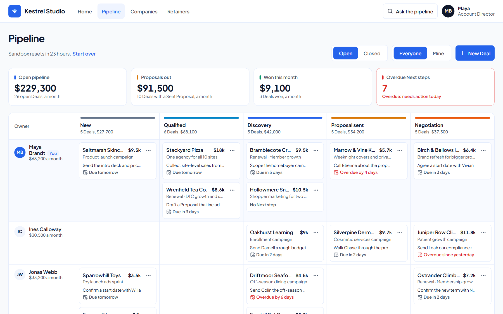
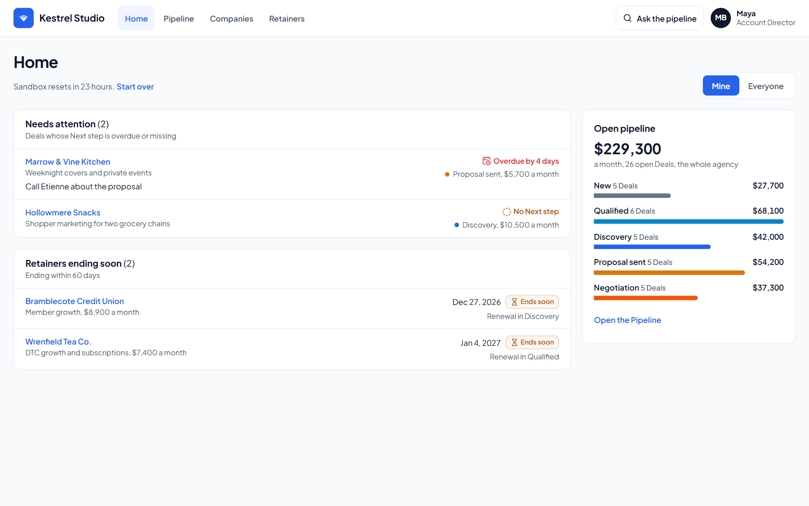
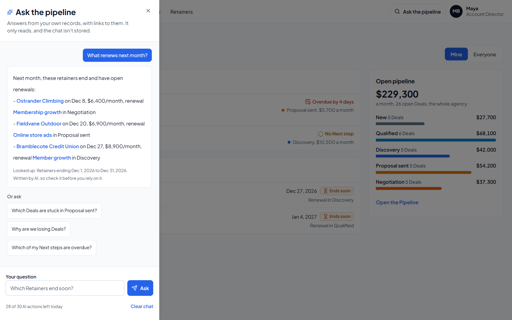
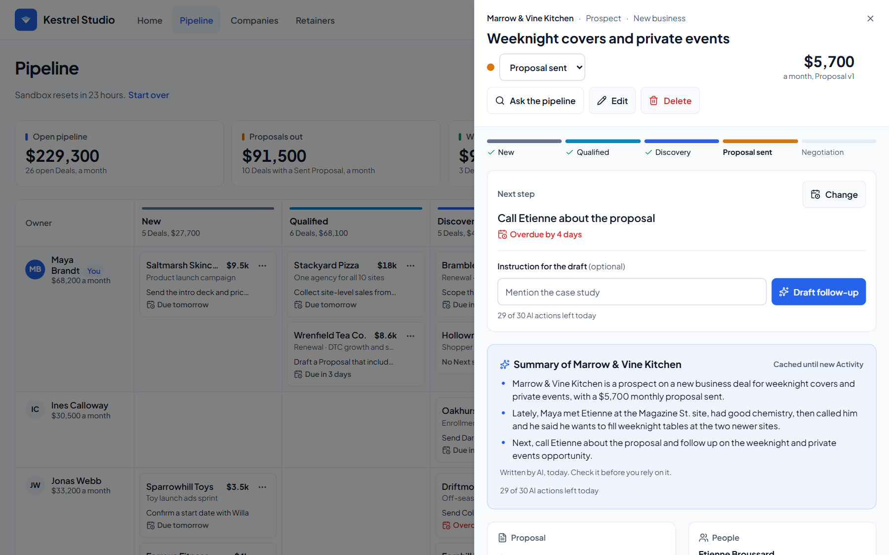
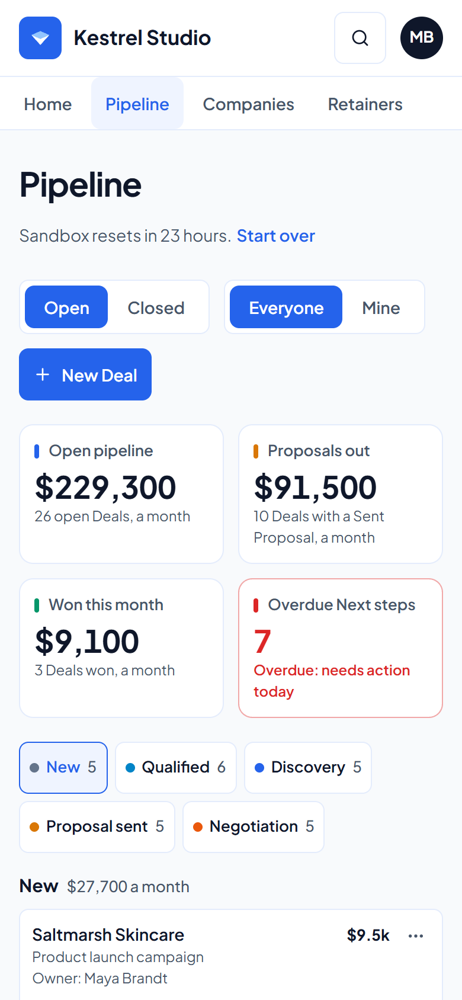

# Kestrel Studio CRM

The CRM of a fictional 12-person marketing agency, with AI built in. It follows the work from a first conversation to a signed retainer and its renewal. It's built as one agency's own tool, not as software for everyone.

**[Try the live demo](https://kestrel-studio-crm.vercel.app).** There's no sign-up. You play Maya, the Account Director, in your own private copy of the agency's data. Change anything: nobody else sees it, and it clears itself after 24 hours.



## A five-minute tour
1. **Home** shows what needs Maya today: overdue Next steps and Retainers about to end.
2. **Pipeline** shows the whole agency at a glance. Move a Deal to another Stage from its menu, or open it beside the board.
3. **Open a Deal** and click Summarize, then Draft follow-up. Edit the draft and log it as sent. Nothing is really sent.
4. **Draft a Proposal, mark it Sent, and win the Deal.** The Proposal is accepted, a Retainer starts, and the Prospect becomes a Client.
5. **Ask the pipeline** something, such as "What renews next month?"
6. **Start over** puts the sample data back.



## The AI
- **Summarize** tells a Company's story in three lines, from its Activities, Deals and Retainers. It's kept until something new is logged, and then marked as out of date.
- **Draft follow-up** writes the next email for a Deal, with an optional one-line instruction.
- **Ask the pipeline** answers questions by looking things up. The model can only call five fixed, read-only lookups, each through the visitor's own sign-in. It names records by short names like "D1", and the app puts in the real name and link, so a link can only lead to a record a lookup found. Each answer says what was looked up.





In the demo's first real calls, a question cost about $0.003 on average, and a summary or a draft $0.001 or less.

## How it works
- **Real sign-in, no form.** "Open the demo" creates a Supabase anonymous user and fills a private Sandbox with sample data. Row-level security keeps each visitor to their own rows, even against direct API calls. See [ADR 0001](docs/adr/0001-sandboxes-via-anonymous-auth-and-rls.md).
- **The rules live in the database.** Winning a Deal is one function that accepts the Proposal and starts or extends the Retainer together. Triggers stop anyone setting Won, or adding a Retainer, any other way.
- **One module for all data.** Every screen goes through [`lib/crm`](lib/crm), which is also what the tests call.
- **Dates follow the visitor.** Sample dates move to the day you open the demo, and "overdue" goes by your own calendar.
- **It cleans up after itself.** An hourly job inside the database removes expired Sandboxes and their anonymous users. See [ADR 0002](docs/adr/0002-everything-runs-in-the-app-not-n8n.md).

## Built for a public demo
- **AI limits:** 30 AI actions per visitor and a daily limit for the whole demo, counted in the database before the AI is called. A question counts as one, however many lookups it takes.
- **Visitor limits:** 5 Sandboxes per network in 24 hours. Addresses are only stored as salted hashes.
- **What the AI gets is capped,** and OpenAI is asked not to store it.
- **No service key in the app.** Request code only uses the public key and the visitor's own session.
- **All sample data is made up.** Company names were checked against real businesses, and contact details use reserved `.example` addresses and 555-01xx numbers.

## Tested
312 tests call the CRM module as real anonymous users, against a local Supabase with the real migrations, row-level security and sign-in. The AI is a fake one in tests, so they cost nothing.

- **Isolation and limits come first:** one visitor can never read or change another's data, and the AI limits hold when requests arrive at the same moment.
- **Race conditions have tests too.** Start over works while a save is in progress, after a plain lock turned out to deadlock with it.
- **The real AI got some answers wrong, and those became tests.** Asked what renews "next month", it looked 31 days ahead and missed a Retainer. Its lookups now take exact dates.
- **The live project is checked from outside** by a script that acts as two visitors with only the public key.

It also works on a phone, where the Pipeline shows one Stage at a time.



## Built with
Next.js 16 (App Router, Cache Components), React 19, TypeScript, Tailwind CSS 4, shadcn/ui, Supabase (Postgres, Auth, row-level security, pg_cron), OpenAI API, Vitest, Vercel.

## Run it yourself
You need Node 24 and Docker Desktop.

```bash
npm install
npm run db:start        # local Supabase in Docker, with the sample data
cp .env.example .env    # then fill in the local URL and key from `npx supabase status`
npm run dev             # http://localhost:3000
```

Set `AI_PROVIDER=fake` in `.env` to run without an OpenAI key. `npm test` runs the tests, and needs the local Supabase running.

## Where things are
| Folder | What's in it |
|---|---|
| `app/`, `components/` | Screens and interface |
| `lib/crm/` | The CRM module: rules, queries, prompts and the AI's lookups |
| `lib/ai/` | The AI provider interface, with an OpenAI and a fake one |
| `supabase/` | Migrations, the sample data, and the SQL used to go live |
| `tests/` | The tests |
| `docs/` | Decisions (ADRs); the terms used are in [GLOSSARY.md](GLOSSARY.md) |

Built by [Zeki](https://workwithbori.cloud). Kestrel Studio is fictional.
